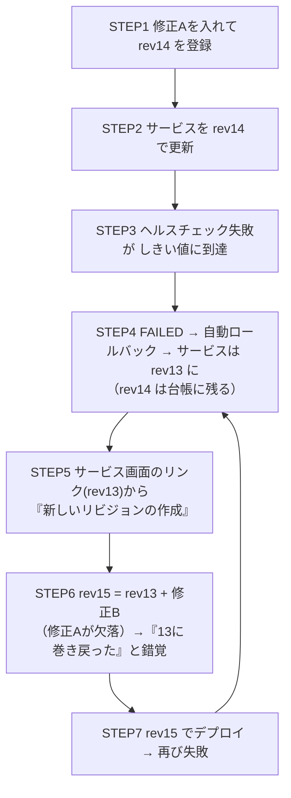
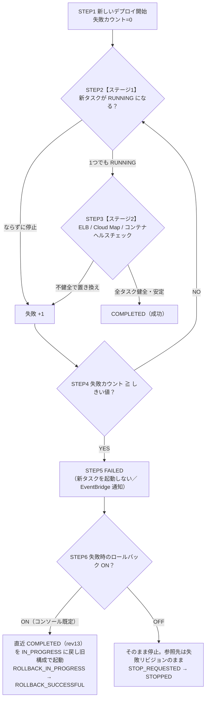

# ECSサービスデプロイ失敗時に「タスク定義が巻き戻る」現象の徹底解説

> サーキットブレーカー／ロールバックの根本原因・動作原理・設定・歴史を、小学生にもわかるたとえで解説
> 情報時点：2026年10月3日（AWS 公式ドキュメント・What's New を確認）
> 同内容の Excel 版：`ECSサービスデプロイ_ロールバック解説.xlsx`

---

## 目次

0. [結論（まずはここだけ読めばOK）](#0-結論まずはここだけ読めばok)
1. [結論サマリ（一問一答）](#1-結論サマリ一問一答)
2. [小学生にもわかる たとえ話](#2-小学生にもわかる-たとえ話--レストランのレシピノートとしおり)
3. [根本原因の分析（5つの層）](#3-根本原因の分析--5つの層で分解する)
4. [動作原理](#4-動作原理--サーキットブレーカーとロールバックの仕組み)
5. [動作イメージ（時系列）](#5-動作イメージ--時間の流れで見る巻き戻り)
6. [巻き戻さない設定はできる？（6方式の比較）](#6-巻き戻さない設定はできる--6つの方式を比較)
7. [設定手順・確認コマンド](#7-設定手順確認コマンド)
8. [推奨運用チェックリスト](#8-推奨運用チェックリスト--ループを断ち切る)
9. [そもそもの失敗原因の調べ方](#9-そもそもの失敗原因を調べる)
10. [登場の歴史と背景](#10-登場の歴史と背景--なぜ自動で戻す仕組みが必要になったのか)
11. [用語集](#11-用語集)
12. [参考情報](#12-参考情報)

### このドキュメントの前提

| 項目 | 内容 |
|---|---|
| 対象 | Amazon ECS のサービス（デプロイコントローラー：ECS、デプロイ戦略：ローリングアップデート）。Fargate／EC2 どちらも考え方は同じです。 |
| 想定シナリオ | リビジョン13で成功 → 14以降でコンテナヘルスチェックに失敗 → サーキットブレーカー発動 → 13に戻る、をコンソールの「サービスを更新」で繰り返している。 |
| 対象外（補足のみ） | CodeDeploy による Blue/Green（ロールバック設定は CodeDeploy 側）。ECS 組み込みの Blue/Green・リニア・カナリア（2025年〜）も、失敗時は元のサービスリビジョンに戻るのが基本です。 |
| 表記 | rev13 ＝ タスク定義「ファミリー名:13」。CB ＝ デプロイサーキットブレーカー。 |

---

## 0. 結論（まずはここだけ読めばOK）

> **結論①　巻き戻っているのは「タスク定義」ではなく、「サービスがどのリビジョンを使うか」という指定（しおり）です。**
> 原因は ECS のデプロイサーキットブレーカーの **『失敗時のロールバック（Rollback on failures）』** 機能。新しいコンソールでサービスを作ると**既定で ON** になっており、失敗が一定回数（既定：必要タスク数×50%、最小3・最大200）に達すると、最後に成功した（COMPLETED）デプロイ＝リビジョン13の構成へ自動的に戻します。

> **結論②　タスク定義のリビジョン14・15…は、ロールバックで消されも書き換えられもしません（イミュータブル）。**
> それでも「13に戻って番号だけ増える」ように見えるのは、**次の修正を“サービスが今指している13”をコピーして作っているため**。14で直した内容が15に入らず、同じ失敗とロールバックを繰り返すループになります。

> **結論③　『失敗時のロールバック』を OFF（`rollback=false`）にすれば、失敗してもサービスは新しいリビジョンを指したまま停止し、自動では戻りません（設定可能）。**
> ただし本番では安全装置を外すことになるため、①新リビジョンは必ず最新リビジョン（または Git 管理の JSON）から作る、②`run-task` でサービス外で単体検証、③開発環境のみロールバック OFF、④2026年7月追加のしきい値設定で判定を調整、の組み合わせを推奨します。

---

## 1. 結論サマリ（一問一答）

| No | 質問 | ひとことで | くわしく |
|---|---|---|---|
| 1 | なぜ失敗するたびに rev13 に戻るのか？ | デプロイサーキットブレーカーの「失敗時のロールバック」が働いているから。 | 「タスクが RUNNING にならない」「ヘルスチェックに失敗して置き換えられる」という失敗の数が“しきい値”に達すると、ECS はそのデプロイを `FAILED` にします。ロールバックが ON だと、直近で `COMPLETED` になっているデプロイ（＝rev13 を使っていたデプロイ）を再び `IN_PROGRESS` にして旧構成のタスクを起動し直します。結果、サービスの「タスク定義」欄が rev13 に戻ります。 |
| 2 | タスク定義そのものが13の内容に書き換えられている？ | いいえ。作成・削除・変更はされません。 | タスク定義はリビジョン単位でイミュータブル。戻るのは「サービスがどのリビジョン（正確にはサービスリビジョン）を使うか」だけ。AWS ドキュメントにも「ロールバックでは新しいサービスリビジョンは作られず、最後に成功したサービスリビジョンを使う」と明記。rev14・15 は ACTIVE のまま残っています。 |
| 3 | なぜ「13の中身に戻ってリビジョン番号だけ増える」ように見える？ | 次の修正を「サービスが今指している rev13」から作っているため。 | ロールバック後、サービス詳細画面のタスク定義リンクは rev13。そこから「新しいリビジョンの作成」をすると rev13 のコピーが元になり、rev14 の修正（修正A）が入らない rev15 ができます。CI/CD が「サービスの現在のタスク定義」をテンプレートにしている場合も同じ。修正Aが無いので再び失敗 → 再びロールバック…のループに。 |
| 4 | 失敗しても巻き戻らない設定はできる？ | できます。「失敗時のロールバック」を OFF。 | サーキットブレーカーは ON のまま、ロールバックだけ OFF にできます。CloudWatch アラームによる失敗検出を使っている場合は、アラーム側のロールバックも OFF に（どちらか一方でも ON なら戻ります）。 |
| 5 | OFF にすると失敗時どうなる？ | `FAILED` で停止。参照先は失敗リビジョンのまま。新タスクも起動しない。 | ドキュメント上「FAILED 状態のデプロイは新しいタスクを起動しない」。サービスデプロイの状態は `STOP_REQUESTED → STOPPED`。旧タスクは止められていなければ動き続けますが、`minimumHealthyPercent` が低いと旧タスクの一部が先に止められ、容量不足のまま止まるリスクがあります。 |
| 6 | サーキットブレーカー自体を OFF にしたら？ | 成功するまで永久に再試行（非推奨）。 | デプロイは `IN_PROGRESS` のまま終わりません。RUNNING にならないタスクは「サービススロットリング」で再試行間隔が最大27分まで伸びますが、ヘルスチェック失敗による停止はスロットリング対象外のため、失敗→再起動を繰り返してログや費用がかさむことがあります。 |
| 7 | おすすめの対処は？ | 本番はロールバック ON のまま、「作り方」と「試し方」を変える。 | ①新リビジョンは最新リビジョン or Git の JSON から作る ②更新画面でリビジョン番号を毎回確認 ③`run-task` で単体検証 ④開発・検証環境だけロールバック OFF ⑤起動が遅いアプリは `startPeriod`／猶予期間／しきい値を調整 ⑥停止理由・ログから根本原因を潰す。 |
| 8 | 最新（2024〜2026）で役立つ機能は？ | しきい値調整、ワンクリック・ロールバック、デプロイ履歴、Action Logs。 | 2026/07：しきい値と数え方を設定可能に。2025/05：`stop-service-deployment` による手動ロールバック。2024/11：サービスリビジョン／デプロイ履歴。2026/07：Action Logs（Amazon Q による原因分析）。2026/09：Early Success Criteria。 |

---

## 2. 小学生にもわかる たとえ話 ― レストランの「レシピノート」と「しおり」

### 登場人物（ECS の用語 ⇔ レストラン）

| ECS の用語 | たとえ | ひとことで言うと |
|---|---|---|
| タスク定義 | レシピノートの1ページ | 料理の作り方を書いた紙。材料（コンテナイメージ）、量（CPU・メモリ）、味見の方法（ヘルスチェック）などが書いてある。 |
| リビジョン（13、14、15…） | ページ番号 | 書き直すたびに新しいページが1枚増える。前のページは消しゴムで消せないし、破られることもない。 |
| サービス | 店長（厨房の責任者） | 「いつも○皿、このページのレシピで作り続けてね」という約束を守り続ける係。 |
| サービスが使うリビジョン | **しおり** | ノートの「どのページで作るか」を示すしおり。**今回“巻き戻っている”のは、実はこのしおり。** |
| タスク | 出来上がった料理（お皿） | レシピ通りに実際に作られたもの。 |
| コンテナヘルスチェック | 味見係 | 一定時間ごとに「おいしい？」とチェック。決められた回数続けてダメなら「ダメ」と判定。 |
| ロードバランサー | ウェイター | お客さんに料理を運ぶ係。ダメな料理は運ばない。 |
| デプロイ | 新メニューへの切り替え | 古い料理を少しずつ新しい料理に入れ替える作業。 |
| デプロイサーキットブレーカー | 家のブレーカー（安全装置） | 失敗が続いたら「新メニュー中止！」とバチンと止めて、お店を守る。 |
| 失敗時のロールバック | しおりを戻すスイッチ | 中止したあと、しおりを「最後にうまくいったページ」に自動で戻すかどうか。 |
| しきい値 | 「何回失敗したら中止するか」 | ふつうは「作るお皿の数の半分」。ただし最低3回、最大200回。 |
| サービスリビジョン | 調理記録帳 | 「どのページを、どの材料（イメージの指紋＝ダイジェスト）で、どんな厨房の設定で作ったか」の記録。戻るときはこの記録どおりに戻す。 |

### お話：なぜ「13ページに巻き戻る」の？

1. あるレストランでは、レシピノートの**13ページ**の料理が大人気。毎日うまく作れていました。（rev13 で成功）
2. あなたは料理を良くしようと、**14ページ**に新しいレシピ（修正A）を書きました。13ページはそのまま残っています。（rev14 を登録）
3. 店長に「しおりを14ページにはさみ替えて！」とお願いしました。（サービスを更新）
4. 厨房で14ページの料理を作り始めましたが、味見係が「ダメ！」「ダメ！」と言い続けます。（コンテナヘルスチェック失敗）
5. ダメが3回続いたところで、安全装置がバチン！「新メニュー中止！」（サーキットブレーカーが FAILED と判定）
6. 「しおりを戻すスイッチ」が ON なので、店長はしおりを**最後にうまくいった13ページ**に戻します。（ロールバック）
7. **★ここが大事★　14ページは破られていません。ノートにちゃんと残っています。戻ったのは「しおり」だけです。**
8. 次にあなたが直そうとしたとき、**しおりがはさまっている13ページ**を開いて写し、修正Bだけを足して15ページを書きました。（rev13 をコピーして rev15 を作成）
9. すると15ページには、14ページで直した修正Aが入っていません。「あれ？ ノートが13ページに巻き戻った！？」と感じてしまうのです。
10. 修正Aが無いのでまた失敗 → またしおりが13に戻る → また13を写す…。ページ番号だけが増え、中身はいつも「13ページ＋ちょっと」のままのループになります。
11. **解決のコツ**：①新しいページは「いちばん新しいページ」か「自分の下書き帳（Git）」から書く。②しおりをはさむ前にページ番号を確認。③お店に出す前に試食コーナー（`run-task`）で味見。④練習用のお店（開発環境）なら「しおりを戻すスイッチ」を切ってもOK。

### 「しおりを戻さない」スイッチはあるの？

- **あります。** 安全装置には『①失敗を見つけて止める』と『②しおりを自動で戻す』の2つの働きがあり、**②だけを切る**ことができます（＝失敗時のロールバックを OFF）。
- でも注意！ 本番のお店で②を切ると、新しい料理づくりは止まるのに、しおりは失敗したページのまま。お皿が足りないまま止まることもあります。だから「本番はスイッチ ON、練習のお店では OFF」がおすすめです。
- ①まで切る（安全装置ごと外す）と、ダメな料理を永遠に作り直し続けます。これはおすすめしません。

---

## 3. 根本原因の分析 ― 5つの層で分解する

「なぜ戻るのか」と「なぜ“タスク定義が”戻ったように見えるのか」は、**別々の原因**です。

| 層 | 原因 | 何が起きているか | 確認する場所・方法 |
|---|---|---|---|
| ① 直接原因（ECS の仕様） | CB の「失敗時のロールバック」が ON | 失敗数がしきい値に達すると `FAILED`。ロールバック ON なら、直近の `COMPLETED` デプロイ（rev13）を `COMPLETED → IN_PROGRESS` に戻して旧構成のタスクを起動。サービスのタスク定義欄が rev13 になる。 | サービスの「デプロイ」「イベント」タブ。`describe-services` の `rolloutState`／`rolloutStateReason`、`list-service-deployments` の `status` |
| ② 既定値（気づきにくさ） | 新コンソールでのサービス作成時、CB＋ロールバックが**既定で ON** | 自分で有効にした覚えがなくてもロールバックが働く。CLI／API／CloudFormation で作成した場合の既定は「無効」なので、環境ごとに挙動が違い混乱しやすい。 | 「サービスを更新」→「デプロイの失敗検出」。`deploymentConfiguration.deploymentCircuitBreaker` |
| ③ 引き金 | コンテナヘルスチェック失敗／RUNNING にならない | ステージ1：RUNNING にならず停止で失敗+1。ステージ2：ELB・Cloud Map・コンテナヘルスチェックで不健全→置き換えで失敗+1。しきい値は「必要タスク数×50%（切り上げ）、最小3・最大200」。2024年1月に最小値が 10→3 になり、小規模サービスは3回の失敗ですぐ戻る。 | 停止タスクの停止理由、終了コード、`healthStatus`、CloudWatch Logs |
| ④ 構造（設計思想） | タスク定義（不変の台帳）とサービス（参照＋デプロイ履歴）は別物 | ロールバックは「最後に成功したサービスリビジョン」への切り替え。新しいタスク定義リビジョンもサービスリビジョンも作らない。 | タスク定義一覧で rev14・15 が ACTIVE のまま残っていることを確認 |
| ⑤ 見え方の原因（運用・スクリプト） | 次の修正を「サービスが今指している rev13」から作っている | サービス画面のリンク（rev13）から「新しいリビジョンの作成」→ rev13 のコピーがベース → rev14 の修正が欠落した rev15。CI/CD の `describe-services → describe-task-definition → register` も同様。 | 各リビジョンの JSON を diff |
| 補足（イメージ） | タグを上書きしても、ロールバックは rev13 当時のダイジェストで起動 | 2024年7月の「ソフトウェアバージョン一貫性」により、デプロイ開始時にタグ→ダイジェストを確定。ロールバックではその記録が使われる。 | `describe-tasks` の `containers[].imageDigest` |

### 原因の連鎖（ループの正体）



> **ひとことでまとめると**：『13に戻る』のは ECS の安全装置が本番を守るために“正しく”動いた結果（仕様）。『タスク定義が巻き戻ったように見える』のは、ロールバック後の rev13 をベースに次のリビジョンを作ってしまう運用上の落とし穴。前者は設定で、後者は作り方を変えれば止められます。

---

## 4. 動作原理 ― サーキットブレーカーとロールバックの仕組み

### 4-1. タスク定義とサービスは「別の箱」

| 観点 | タスク定義（Task Definition） | サービス（Service） | ロールバックでは？ |
|---|---|---|---|
| 役割 | 設計図（イメージ、CPU／メモリ、起動方法、ヘルスチェック） | 実行管理者（どの設計図のタスクを何個、どのネットワーク／LB で動かすか） | ロールバックは「サービス」側の出来事 |
| 変更方法 | 新リビジョンを登録（`RegisterTaskDefinition`）。既存は変更不可 | `UpdateService`（「サービスを更新」） | ― |
| 履歴 | リビジョン番号 1,2,3…（番号は再利用されない） | サービスデプロイ＋サービスリビジョン（2024/10/25 以降作成分、直近90日表示） | 新しいサービスリビジョンは作られず、最後に成功したものを再利用 |
| 状態 | ACTIVE／INACTIVE／DELETE_IN_PROGRESS | `rolloutState`：IN_PROGRESS／COMPLETED／FAILED | ― |
| 影響 | **なし**（rev14・15 は ACTIVE のまま） | 参照先が最後に成功したサービスリビジョンに戻る | 見た目上「サービスのタスク定義が13に戻る」 |

```
 ┌──────────── タスク定義（台帳：消えない・変わらない） ────────────┐
 │  rev12   rev13   rev14(13+A)   rev15(13+B)   rev16(13+A+B)      │
 └───────────▲─────────────────────────────────────────────────────┘
             │  ← サービスの「しおり」（参照）。ロールバックで動くのはココだけ
 ┌───────────┴──── サービス ─────────────────────────────────────────┐
 │  サービスリビジョン（調理記録帳）＝ タスク定義 + イメージダイジェスト + 構成  │
 └──────────────────────────────────────────────────────────────────┘
```

### 4-2. サーキットブレーカーの判定フロー



- 既定（`resetOnHealthyTask=true`）では、健全なタスクが出ると失敗カウントは0に戻ります（連続失敗のみカウント）。
- **注意**：`COMPLETED` のデプロイが1つも無い場合（初回デプロイの失敗、ロールバック実行中に次のデプロイを始めて失敗した場合など）は、ロールバック先が無く、新タスクも起動されずに止まります（stalled）。

### 4-3. しきい値の計算

既定は `BOUNDED_PERCENT`（value=50）＝「必要タスク数 × value% を切り上げ、最小3・最大200に収める」。2026年7月からは種類と値を変更できます（Excel 版は入力セルを変えると再計算されます）。

```
しきい値（BOUNDED_PERCENT） = MIN(200, MAX(3, ROUNDUP(value/100 × 必要タスク数)))
```

| 必要タスク数 | BOUNDED_PERCENT（既定） | UNBOUNDED_PERCENT | COUNT（例：5） | 読み方 |
|---:|---:|---:|---:|---|
| 1 | 3 | 1 | 5 | 最小値3が適用。1タスクでも3回失敗で FAILED |
| 2 | 3 | 1 | 5 | 最小値3が適用 |
| 3 | 3 | 2 | 5 | 1.5→2 だが最小値3 |
| 4 | 3 | 2 | 5 | 2→最小値3 |
| 6 | 3 | 3 | 5 | ちょうど3 |
| 10 | 5 | 5 | 5 | 5回で FAILED |
| 25 | 13 | 13 | 5 | 12.5→13（AWS ドキュメントの例と一致） |
| 100 | 50 | 50 | 5 | 50回で FAILED |
| 400 | 200 | 200 | 5 | 上限200 |
| 800 | 200 | 400 | 5 | BOUNDED は上限200、UNBOUNDED なら400 |

※ 2024年1月より前は最小値が10でした。

### 4-4. 失敗の数え方（`resetOnHealthyTask`・2026年7月〜）

| 設定値 | 数え方 | 向いているケース |
|---|---|---|
| `true`（既定） | 健全なタスクが出るたびにカウントを0に戻す（連続失敗だけ数える） | 起動直後に一時的に失敗しても、最終的に安定するアプリ |
| `false` | デプロイ全体で累積。リセットしない | 「ときどき失敗する」状態も見逃さず早めに止めたい場合 |

### 4-5. 状態の対応表（2種類の“状態”がある）

| 場面 | `rolloutState`（DescribeServices） | サービスデプロイの状態（ListServiceDeployments） | 説明 |
|---|---|---|---|
| 開始・進行中 | IN_PROGRESS | PENDING → IN_PROGRESS | 新タスクを起動して入れ替え中 |
| 成功 | COMPLETED | SUCCESSFUL | 次回のロールバック先になる |
| 失敗＋ロールバック ON | 新：FAILED／旧：COMPLETED→IN_PROGRESS→COMPLETED | ROLLBACK_IN_PROGRESS → ROLLBACK_SUCCESSFUL（または ROLLBACK_FAILED） | **今回の現象** |
| 失敗＋ロールバック OFF | FAILED | STOP_REQUESTED → STOPPED | 新タスクを起動しない。参照先は失敗リビジョンのまま |
| 手動ロールバック（2025/05〜） | （ロールバック用デプロイが進行） | ROLLBACK_REQUESTED → ROLLBACK_IN_PROGRESS → … | コンソールの「ロールバック」または `stop-service-deployment --stop-type ROLLBACK` |
| 進行中に別の更新 | 旧デプロイは置き換え | STOP_REQUESTED → STOPPED | 進行中のデプロイに別の更新をかけた場合 |

### 4-6. ロールバックで「戻るもの」と「戻らないもの」

| 区分 | 対象 | 説明 |
|---|---|---|
| 戻る | サービスが使うタスク定義リビジョン | rev15 → rev13 |
| 戻る | コンテナイメージ | rev13 デプロイ時に確定したダイジェストで起動（タグを上書きしていても旧イメージ） |
| 戻る | サービスリビジョンに記録された構成 | 最後に成功したサービスリビジョン（タスク定義、イメージ、ネットワーク・LB 等のデプロイ時の構成） |
| 戻らない | タスク定義 rev14・15 の中身 | ACTIVE のまま残る |
| 戻らない | リビジョン番号のカウンタ | 次は16になる（再利用されない） |
| 戻らない | ECR のイメージ | 削除もタグの付け替えもされない |

---

## 5. 動作イメージ ― 時間の流れで見る「巻き戻り」

### 5-1. ステップごとの動き

| STEP | あなたの操作 | ECS の内部動作 | 台帳 | 参照先 | デプロイ状態 | 見え方 |
|---|---|---|---|---|---|---|
| T1 | （過去に）rev13 でデプロイ | 全タスク健全 | 1〜13 | rev13 | COMPLETED | 正常 |
| T2 | 修正Aを入れて rev14 登録 | 登録のみ | 1〜14 | rev13 | ― | ― |
| T3 | rev14 でサービス更新 | ヘルスチェック失敗→置き換え→失敗数加算 | 1〜14 | rev14（デプロイ中） | IN_PROGRESS | デプロイ中 |
| T4 | （何もしない） | しきい値到達→FAILED→rev13 へ自動ロールバック | 1〜14（rev14 は残る） | rev13 | rev14：FAILED／rev13：COMPLETED | 「13に戻された！」 |
| T5 | サービス画面のリンク（rev13）から新リビジョン作成＋修正B | rev15 = rev13 + 修正B（**修正A 欠落**） | 1〜15 | rev13 | ― | 「13の内容に戻っている！？」 |
| T6 | rev15 でサービス更新 | 修正Aが無いので再び失敗 | 1〜15 | rev15（デプロイ中） | IN_PROGRESS→FAILED | 失敗 |
| T7 | （何もしない） | 再び rev13 へロールバック | 1〜15 | rev13 | COMPLETED | 「また13…」（ループ） |
| **T8** | **最新 rev15（or 14）をベースに 修正A＋B の rev16 を作成、run-task で確認後デプロイ** | 健全 → COMPLETED | 1〜16 | **rev16** | COMPLETED | **解決！** |

### 5-2. リビジョン × 時間 マトリクス図

凡例：● サービスが使用中（しおり）／▲ デプロイ中／× 失敗（でも台帳には残る）／○ 台帳に存在（未使用）／空白 まだ存在しない

| リビジョン（中身） | T1 | T2 | T3 | T4 | T5 | T6 | T7 | T8 |
|---|:-:|:-:|:-:|:-:|:-:|:-:|:-:|:-:|
| rev13（元の成功版） | ● | ● | ● | ● | ● | ● | ● | ○ |
| rev14（13＋修正A） | | ○ | ▲ | × | ○ | ○ | ○ | ○ |
| rev15（13＋修正B、修正A 欠落） | | | | | ○ | ▲ | × | ○ |
| rev16（修正A＋B） | | | | | | | | ● |
| **サービスの参照先** | rev13 | rev13 | rev14 | rev13 | rev13 | rev15 | rev13 | rev16 |

> × になった rev14・rev15 も台帳からは消えていません（T5 以降も ○）。動いているのは ●（しおり）だけ。ループの原因は T5 で rev13 をベースに rev15 を作ったこと。

### 5-3. タスク数の推移イメージ（必要タスク数2・最小100%・最大200%・しきい値3）

※ わかりやすくするための簡略化したイメージです。

| 時点 | rev13（旧） | rev15（新） | 失敗数 | 何が起きているか |
|---|---|---|---|---|
| 0分 | 2（健全） | 0 | 0 | 更新開始。最大200%なので旧2台を残したまま新2台を起動できる |
| 1分 | 2 | 2台起動→1台失敗で置き換え | 1 | ステージ2で失敗検知 |
| 2分 | 2 | 置き換えた1台も失敗 | 2 | 健全な新タスクが出ないのでリセットされない |
| 3分 | 2 | さらに1台失敗 | 3 | しきい値到達 → FAILED |
| 4分（ロールバック ON） | 2 | 0（停止） | ― | rev13 のデプロイを IN_PROGRESS に → 旧2台が健全なので速やかに COMPLETED。サービスは止まらない |
| （参考）ロールバック OFF | 2 | 0（停止） | ― | 新タスク起動を止めて終了。旧2台は動くが参照先は rev15 のまま |
| （注意）最小50% の場合 | 1 になることも | 0 | ― | 旧タスクが先に止められることがあり、ロールバック OFF だと容量不足のまま止まるおそれ |

---

## 6. 巻き戻さない設定はできる？ ― 6つの方式を比較

> **結論**：タスク定義そのもの（rev14・15 の中身）は、もともと巻き戻りません（設定不要）。
> 「失敗してもサービスが新しいリビジョンを指したまま止まってほしい」なら、**サーキットブレーカーは ON のまま『失敗時のロールバック』だけを OFF** にします。CloudWatch アラームによる失敗検出も併用している場合は、そちらのロールバックも OFF に。

| 方式 | 設定値 | 失敗時の動き | 参照先 | メリット | デメリット・リスク | おすすめ |
|---|---|---|---|---|---|---|
| A. 既定（CB ON＋ロールバック ON） | `enable=true, rollback=true` | FAILED → 直近 COMPLETED へ自動で戻す | rev13 に戻る | 本番を自動で守る | 調査中に何度も戻される。次の修正のベースを間違えやすい | ◎ 本番 |
| B. CB ON＋ロールバック OFF | `enable=true, rollback=false` | FAILED で停止。新タスクを起動しない | 失敗リビジョンのまま | 「巻き戻らない」を実現。失敗状態を観察しやすい | 自動復旧しない。容量不足のまま止まることも | ○ 開発・検証／調査中の一時設定 |
| C. CB を OFF | `enable=false` | 判定しない。成功するまで再試行し続ける | 失敗リビジョンのまま（終わらない） | 単純 | デプロイが永遠に終わらない。IaC は待ち続ける。ログ・費用増 | × 非推奨 |
| D. A＋しきい値調整（2026/07〜） | `thresholdConfiguration`、`resetOnHealthyTask` | 多めに許容してから判定 | 最終的に rev13 | 誤ロールバックを減らせる | 本当の故障の検知が遅れる | ○ 起動が遅いアプリの本番 |
| E. B＋手動ロールバック（2025/05〜） | `rollback=false` ＋ `stop-service-deployment --stop-type ROLLBACK` | 自動では戻らないがボタン1つで戻せる | 自分で決める | 戻すかを人が判断できる | 判断が遅れると影響が長引く | ○ 慎重な検証環境 |
| F. サービスを触らず検証（run-task） | 設定変更なし | サービスは影響を受けない | rev13 のまま | 本番に触れずにヘルスチェックの成否を確認 | LB 経由の確認は別途必要 | ◎ すべての環境 |

### 判断のめやす

| あなたの状況 | おすすめ |
|---|---|
| 本番で、とにかく止めたくない | A を維持 ＋ F で事前確認 ＋ 作り方の見直し |
| 開発・検証環境で原因をじっくり調べたい | B（調べ終わったら A に戻す） |
| 起動が遅いアプリで誤ロールバックが多い | D ＋ `startPeriod`／猶予期間の見直し |
| 戻すかどうかを人が判断したい | E |
| 「13に戻る」より「14の修正が消える」のが困る | 設定変更不要。最新リビジョン（or Git の JSON）から作る運用に変更 |

### ロールバックを OFF にする前の注意

- OFF にしても、もともと「タスク定義」は巻き戻らないため、**“14の修正が消える問題”（作り方の問題）は解決しません**。
- CloudFormation／CDK／Terraform などで管理しているサービスをコンソールで変更すると、次回の IaC 適用で元に戻ります。設定は IaC 側で変更してください。
- CloudFormation／CDK では、ECS のデプロイ失敗がスタック更新の失敗となり、ECS とは別に“スタックのロールバック”（前のタスク定義への更新）が起こることがあります。その際、その更新で作られたタスク定義リビジョンが登録解除（INACTIVE）されることもあります（`DeletionPolicy`／`UpdateReplacePolicy: Retain` で保持可能）。
- ロールバック OFF で失敗したら、修正版で再デプロイするか、手動ロールバック（コンソールの「ロールバック」または `stop-service-deployment`）で戻します。

---

## 7. 設定手順・確認コマンド

`<...>` はご自身の値に置き換えてください。

### 7-1. 失敗時のロールバックを OFF にする

**コンソール**

1. ECS コンソール → クラスター → 対象サービスを選択 →「更新」（サービスを更新）
2. 「デプロイの失敗検出」（Deployment failure detection）を開く
3. 「Amazon ECS デプロイサーキットブレーカーを使用」（Use the Amazon ECS deployment circuit breaker）は **ON のまま**
4. その下の **「失敗時のロールバック」（Rollback on failures）のチェックを外す**
5. 「CloudWatch アラームを使用」も ON なら、そちらの「失敗時のロールバック」も外す
6. タスク定義のリビジョン欄が意図した番号か確認して「更新」

**AWS CLI**

```bash
# 現在の設定を確認（maximumPercent / minimumHealthyPercent を控える）
aws ecs describe-services --cluster <cluster> --services <service> \
  --query "services[0].deploymentConfiguration"

# ロールバックだけ OFF（CB は ON）にして rev15 でデプロイ
aws ecs update-service --cluster <cluster> --service <service> \
  --task-definition <family>:15 \
  --deployment-configuration '{"maximumPercent":200,"minimumHealthyPercent":100,"deploymentCircuitBreaker":{"enable":true,"rollback":false}}'
```

- `maximumPercent`／`minimumHealthyPercent` は現在値に合わせて指定してください。
- CloudWatch アラーム併用時は `"alarms":{"alarmNames":[...],"enable":true,"rollback":false}` も指定。
- PowerShell では JSON の引用符に注意。`file://config.json` 形式で渡すと確実です。

**CloudFormation**

```yaml
MyService:
  Type: AWS::ECS::Service
  Properties:
    DeploymentConfiguration:
      MaximumPercent: 200
      MinimumHealthyPercent: 100
      DeploymentCircuitBreaker:
        Enable: true
        Rollback: false
```

**Terraform**

```hcl
resource "aws_ecs_service" "this" {
  # ...
  deployment_circuit_breaker {
    enable   = true
    rollback = false
  }
}
```

**AWS CDK（TypeScript）**

```ts
new ecs.FargateService(this, 'Service', {
  cluster,
  taskDefinition,
  circuitBreaker: { enable: true, rollback: false },
});
```

### 7-2. 判定の厳しさを調整する（しきい値：2026年7月〜／ヘルスチェック）

```bash
aws ecs update-service --cluster <cluster> --service <service> \
  --deployment-configuration '{"maximumPercent":200,"minimumHealthyPercent":100,"deploymentCircuitBreaker":{"enable":true,"rollback":true,"resetOnHealthyTask":true,"thresholdConfiguration":{"type":"COUNT","value":10}}}'
```

- `type`：`BOUNDED_PERCENT`（既定、value=50）／`UNBOUNDED_PERCENT`／`COUNT`。コンソール・CloudFormation・CDK・Terraform でも設定可能（プロパティ名は各リファレンスで確認）。

タスク定義のコンテナヘルスチェック：

```json
"healthCheck": {
  "command": ["CMD-SHELL", "curl -f http://localhost:8080/health || exit 1"],
  "interval": 30,
  "timeout": 5,
  "retries": 3,
  "startPeriod": 120
}
```

- `startPeriod`：0〜300秒（起動中の失敗を数えない猶予）。`interval` 5〜300（既定30）、`timeout` 2〜60（既定5）、`retries` 1〜10（既定3）。
- イメージに `curl` が入っているか要確認。

サービスのヘルスチェック猶予期間：

```bash
aws ecs update-service --cluster <cluster> --service <service> \
  --health-check-grace-period-seconds 180
```

### 7-3. 新しいリビジョンを「最新」から正しく作る

- **コンソール**：「タスク定義」→ ファミリー名 → 最新（または前回修正した）リビジョンを選択 →「新しいリビジョンの作成」。**サービス詳細画面のリンク（ロールバック後は rev13）から辿らない。**

```bash
# リビジョンを省略すると「最新の ACTIVE リビジョン」を取得
aws ecs describe-task-definition --task-definition <family> \
  --query taskDefinition > latest.json

# 登録に不要な読み取り専用フィールドを削除（jq を使用）
jq 'del(.taskDefinitionArn,.revision,.status,.requiresAttributes,.compatibilities,.registeredAt,.registeredBy,.deregisteredAt)' latest.json > td.json

# 編集後に登録
aws ecs register-task-definition --cli-input-json file://td.json

# 差分確認（前回の修正が入っているか）
aws ecs describe-task-definition --task-definition <family>:14 --query taskDefinition > r14.json
aws ecs describe-task-definition --task-definition <family>:15 --query taskDefinition > r15.json
diff r14.json r15.json
```

- 最善はタスク定義 JSON を Git で管理し、そこから登録すること（サービスの現在値をテンプレートにしない）。

### 7-4. サービスを変えずに単体で試す（run-task）

```bash
aws ecs run-task --cluster <cluster> --task-definition <family>:16 \
  --launch-type FARGATE \
  --network-configuration "awsvpcConfiguration={subnets=[<subnet-id>],securityGroups=[<sg-id>],assignPublicIp=DISABLED}"

aws ecs describe-tasks --cluster <cluster> --tasks <task-arn> \
  --query "tasks[0].{last:lastStatus,health:healthStatus,stop:stoppedReason,containers:containers[].{name:name,health:healthStatus,exit:exitCode,reason:reason}}"
```

- サーキットブレーカーの対象外なので、何度失敗してもサービスは rev13 のまま。確認後は `stop-task` で停止。キャパシティプロバイダー利用時は `--capacity-provider-strategy` を指定。

### 7-5. 状態・履歴の確認／手動ロールバック／通知

```bash
# デプロイの状態（rolloutState と理由、CB が数えた失敗数）
aws ecs describe-services --cluster <cluster> --services <service> \
  --query "services[0].deployments[].{status:status,taskDef:taskDefinition,rollout:rolloutState,reason:rolloutStateReason,failed:failedTasks}"

# サービスデプロイ履歴（ROLLBACK_SUCCESSFUL などを確認）
aws ecs list-service-deployments --cluster <cluster> --service <service>
aws ecs describe-service-deployments --service-deployment-arns <arn>

# 直近のイベント
aws ecs describe-services --cluster <cluster> --services <service> \
  --query "services[0].events[0:10].[createdAt,message]" --output table

# 手動ロールバック（2025/05〜、ロールバック設定が OFF でも使える）
aws ecs stop-service-deployment --service-deployment-arn <arn> --stop-type ROLLBACK
```

EventBridge ルール（デプロイ失敗を通知）：

```json
{
  "source": ["aws.ecs"],
  "detail-type": ["ECS Deployment State Change"],
  "detail": { "eventName": ["SERVICE_DEPLOYMENT_FAILED"] }
}
```

---

## 8. 推奨運用チェックリスト ― ループを断ち切る

| No | 区分 | チェック項目 | 理由・効果 |
|---|---|---|---|
| 1 | 作成 | ☐ 新リビジョンは「タスク定義」画面から、最新（または直前に修正した）リビジョンを選んで作成 | サービス画面のリンクはロールバック後 rev13 を指すため |
| 2 | 作成 | ☐ 作成前に「ベースにするリビジョン番号」を確認 | ベースの取り違えがループの正体 |
| 3 | 作成 | ☐ 登録後、前回リビジョンと JSON の差分を確認 | 修正Aの欠落を防ぐ |
| 4 | 作成 | ☐ タスク定義 JSON を Git で管理し、そこから登録 | 「サービスの現在値」に依存しない |
| 5 | 検証 | ☐ サービス更新前に `run-task` で単体起動し `HEALTHY` を確認 | 本番に触れずに失敗を発見 |
| 6 | デプロイ | ☐ 更新画面でリビジョン番号を毎回目で確認 | 意図しないリビジョンでのデプロイ防止 |
| 7 | 監視 | ☐ EventBridge で `SERVICE_DEPLOYMENT_FAILED` を通知 | ロールバックにすぐ気づける |
| 8 | 調査 | ☐ 「デプロイ」タブ・イベント・停止理由・終了コード・ログを確認 | 根本原因の特定 |
| 9 | 調整 | ☐ `startPeriod` とヘルスチェック猶予期間を起動時間に合わせる | 誤ロールバック防止 |
| 10 | 調整 | ☐ 必要に応じ `thresholdConfiguration`／`resetOnHealthyTask` を見直す（2026/07〜） | 判定の厳しさをアプリに合わせる |
| 11 | 環境 | ☐ 開発・検証環境だけロールバック OFF（調査後は戻す） | 失敗状態を観察できる |
| 12 | 本番 | ☐ 本番はロールバック ON を維持し、手動ロールバック手順も把握 | 安全装置を外さない |
| 13 | IaC | ☐ IaC 管理のサービスは IaC 側で設定変更 | 次回適用で設定が戻るのを防ぐ |

---

## 9. そもそもの失敗原因を調べる

ロールバックは“結果”。ループを止める本当の解決は、**rev14 以降が失敗する理由をつぶすこと**です。

### 9-1. 調べる順番

1. サービス →「デプロイ」タブ：どのデプロイが失敗し、何に戻ったか（失敗タスク数、ロールバック理由、ソース／ターゲットのサービスリビジョン）
2. サービス →「イベント」タブ：起動・停止・失敗・ロールバックの時系列
3. タスク →「停止済み」→ 停止理由（例：`Task failed container health checks`／`Essential container in task exited`／`CannotPullContainerError`）と終了コード
4. CloudWatch Logs：アプリの起動ログ・エラー
5. Action Logs（2026/07〜）・Amazon Q：デプロイ中の ECS の動作記録と原因分析
6. `run-task` ＋ ECS Exec：コンテナ内でヘルスチェックコマンドを手動実行

### 9-2. よくある原因と対処

| 症状・メッセージ | よくある原因 | 確認方法 | 対処 |
|---|---|---|---|
| コンテナが UNHEALTHY（すぐ失敗） | `curl`／`wget` がイメージに無い（slim・alpine・distroless） | ECS Exec で `which curl`、ログに `curl: not found` | curl を追加 or アプリ内蔵のヘルスチェックコマンド |
| 起動直後だけ UNHEALTHY | `startPeriod` が短い（Java／Rails／大きなモデル読み込み） | 起動完了時刻とタスク開始時刻の差 | `startPeriod`（最大300秒）延長、猶予期間設定 |
| ずっと UNHEALTHY | ポート・パスの間違い、待ち受けアドレスの誤り | コンテナ内で手動実行 | コマンドとアプリ設定を一致させる |
| CMD-SHELL の書式ミス | `["CMD-SHELL", "curl -f http://localhost:8080/health \|\| exit 1"]` になっていない | タスク定義 JSON | 正しい書式に修正 |
| 終了コード 137／OutOfMemory | メモリ不足（OOM Kill） | 停止理由、メトリクス | メモリ増、JVM ヒープ等の見直し |
| 終了コード 1 などで即終了 | 環境変数・シークレット不足、設定誤り | ログ | 定義を修正。**前回修正の欠落（rev13 ベース問題）も疑う** |
| CannotPullContainerError | イメージ名・タグ誤り、ECR 権限、NAT／VPC エンドポイント無し | 停止理由 | イメージ URI、実行ロール、ネットワーク経路 |
| ResourceInitializationError | Secrets Manager／SSM の取得失敗 | 停止理由 | 実行ロール権限、VPC エンドポイント |
| exec format error | CPU アーキテクチャ不一致（ARM64 イメージを X86_64 で実行等） | ログ | `runtimePlatform` とビルド対象を合わせる |
| ターゲットが unhealthy（ELB） | TG のヘルスチェックのパス・ポート・成功コード、SG | TG 画面のヘルス理由 | ALB 設定・SG 修正、猶予期間設定 |

---

## 10. 登場の歴史と背景 ― なぜ「自動で戻す」仕組みが必要になったのか

### 年表

| 年月 | 出来事 | 背景・なぜ必要になったか | 今回の現象との関係 |
|---|---|---|---|
| 2014/11（2015/04 GA） | Amazon ECS 発表（re:Invent） | コンテナを大規模に動かす管理サービスが必要に。タスク定義は最初から「リビジョン付き・変更不可」 | rev14・15 が消えない・変わらない理由 |
| 2015〜 | サービススケジューラとローリングアップデート | 止めずに新旧タスクを入れ替えたい | 当初は「失敗したら止める・戻す」機能が無かった |
| 2017/11 | AWS Fargate 登場 | サーバー管理不要 → デプロイ回数が増加 | 失敗対策のニーズが高まる |
| 2018/03 | コンテナヘルスチェックに対応 | 「アプリが本当に元気か」を判定したい | 今回の失敗の“引き金” |
| 2018/11 | CodeDeploy による Blue/Green | 安全な切り替えと切り戻し | ローリングとは別の仕組み |
| 〜2020 | 「終わらないデプロイ」問題 | 壊れた版を出すと起動→失敗→再起動を延々と繰り返す。CloudFormation は長時間止まる。利用者は Lambda 等で自作ロールバック | 自動で止めて戻す仕組みが求められた |
| **2020/11〜12** | **デプロイサーキットブレーカー登場**（11月プレビュー、12月 GA）。rollback オプション付き | 「自動で検知して止める」「最後に成功した状態へ自動で戻す」を標準機能に | **今回の“直接原因”** |
| 2022/12 | CloudWatch アラームによるロールバック | ヘルスチェックは通るがエラー率・レイテンシが悪化するケースも検知 | アラーム側にもロールバックがある |
| （時期非公表） | 新コンソールで「CB＋ロールバック」が既定 ON | 安全装置の付け忘れ防止 | 意識せずロールバックが有効な理由 |
| 2024/01 | しきい値の最小値 10 → 3 | 小規模サービスでも素早く検知 | 3回の失敗ですぐ戻る理由 |
| 2024/07 | ソフトウェアバージョン一貫性（タグ→ダイジェスト固定） | 同じデプロイで別々のイメージが動く事故を防ぐ | ロールバック時も rev13 当時のイメージ |
| 2024/11 | サービスリビジョンとデプロイ履歴（2024/10/25 以降） | 「何に戻したか」を見える化 | ロールバック先を確認できる |
| 2025/05 | ワンクリック・ロールバック（`StopServiceDeployment`） | 検知できない失敗も手動ですぐ戻したい | ロールバック OFF 運用の“保険” |
| 2025/07 | ECS 組み込み Blue/Green ＋ ライフサイクルフック | CodeDeploy なしで安全に切り替え | ローリング以外の選択肢 |
| 2025/10〜11 | 組み込みリニア／カナリア（2026/02 に NLB 対応） | 少しずつトラフィックを移す | ローリング以外の選択肢 |
| 2026/01 | コンテナのヘルス状態を CloudWatch メトリクスとして発行 | ヘルス状態を監視・アラームに | 失敗傾向の把握 |
| **2026/07** | **サーキットブレーカー設定のカスタマイズ**（しきい値の種類・値、連続／累積） | 起動時に一時失敗するアプリの誤ロールバック、開発環境での早期ロールバックなどの要望 | 判定の厳しさを調整可能に |
| 2026/07 | Action Logs（Amazon Q による原因分析） | ロールバック理由を素早く突き止めたい | 原因調査が容易に |
| 2026/09 | Early Success Criteria と Deferred cleanup | 全台そろうのを待たずに成功判定したい | 成功判定のタイミングを調整可能に |

### なぜ必要になったのか（流れでわかる背景）

1. **昔**：デプロイは人が手で行い、失敗したら人が手で戻していました。障害の多くは「変更（デプロイ）」がきっかけで起こるため、「失敗したらすぐ戻す」ことが復旧時間（MTTR）を縮める一番の近道でした。
2. **コンテナの時代**：ECS や Fargate でデプロイが簡単・高頻度になり、「壊れた版を出しても、自動で止まって自動で戻る」仕組みが不可欠に。それがデプロイサーキットブレーカー（2020年）です。家のブレーカーが電気の使いすぎで落ちて家を守るように、失敗が続いたらデプロイを止めて本番を守ります。
3. **安全側の既定値**：安全装置の付け忘れを防ぐため、新しいコンソールでは CB とロールバックが最初から ON。これが「気づいたら毎回13に戻されている」体験につながります。
4. **見える化と微調整**：履歴（2024年）、手動ロールバック（2025年）、判定の調整（2026年）と、「安全装置を外さずに、使いやすくする」方向に進化してきました。
5. **つまり**：今回の現象は、ECS が本番を守るために長年かけて育ててきた仕組みが“正しく”動いた結果。開発中の不便さは、設定（ロールバック OFF・しきい値調整）と運用（最新リビジョンから作る・run-task で試す）で解消できます。

---

## 11. 用語集

| 用語 | 英語・API 名 | 意味 |
|---|---|---|
| タスク定義 | Task Definition | コンテナの設計図（イメージ、CPU／メモリ、ポート、環境変数、ヘルスチェック等） |
| リビジョン | Revision | タスク定義の版番号。登録ごとに+1。既存版は変更不可。番号は再利用されない |
| ファミリー | Family | タスク定義の名前（`family:13` のように使う） |
| ACTIVE／INACTIVE | Task definition status | 使用可能／登録解除済み。INACTIVE でも既存のタスク・サービスは動き続ける |
| サービス | Service | 指定したタスク定義で指定数のタスクを動かし続ける仕組み |
| デプロイ | Deployment | サービスの構成を新しいものに切り替える処理 |
| ローリングアップデート | Rolling update（ECS デプロイコントローラー） | 旧タスクを少しずつ新タスクに入れ替える方式 |
| 最小実行タスク％ | `minimumHealthyPercent` | デプロイ中に最低限動かしておくタスクの割合 |
| 最大実行タスク％ | `maximumPercent` | デプロイ中に同時に動かせるタスクの上限割合 |
| デプロイサーキットブレーカー | Deployment circuit breaker | 失敗が続いたデプロイを自動で FAILED にする安全装置 |
| 失敗時のロールバック | `rollback`（Rollback on failures） | FAILED 時に最後に成功したデプロイへ自動で戻すオプション |
| しきい値 | `thresholdConfiguration` | 何回失敗したら FAILED にするか（既定：必要タスク数×50%、最小3・最大200） |
| 連続／累積カウント | `resetOnHealthyTask` | true＝健全タスクでリセット（既定）、false＝累積 |
| rolloutState | `rolloutState` | デプロイ単位の状態（IN_PROGRESS／COMPLETED／FAILED） |
| サービスデプロイ | Service deployment | デプロイ1回分の記録（状態、失敗数、ロールバック情報） |
| サービスリビジョン | Service revision | デプロイしようとした構成のスナップショット（変更不可）。ロールバック先 |
| コンテナヘルスチェック | `healthCheck` | コンテナ内でコマンドを実行して健康状態を判定 |
| startPeriod | `startPeriod` | 起動直後の失敗を数えない猶予（0〜300秒） |
| ヘルスチェック猶予期間 | `healthCheckGracePeriodSeconds` | 起動後しばらく不健全判定を無視する秒数 |
| イメージダイジェスト | Image digest（sha256） | イメージの中身から計算される固有の指紋 |
| ソフトウェアバージョン一貫性 | Software version consistency | デプロイ開始時にタグ→ダイジェストを確定し全タスクを同じイメージで動かす |
| run-task | `RunTask` | サービスを介さずタスクを単体起動する API |
| stop-service-deployment | `StopServiceDeployment` | 進行中のデプロイを止めてロールバックする API（2025/05〜） |
| EventBridge | Amazon EventBridge | ECS のイベントを受けて通知・自動化 |
| Action Logs | Action Logs | デプロイ中に ECS が実行した動作の記録（2026/07〜） |

---

## 12. 参考情報

2026年10月3日に確認。

**AWS 公式ドキュメント**

- [How the Amazon ECS deployment circuit breaker detects failures](https://docs.aws.amazon.com/AmazonECS/latest/developerguide/deployment-circuit-breaker.html) — 判定の2段階、COMPLETED へのロールバック、しきい値計算、FAILED では新タスクを起動しない
- [Amazon ECS service revisions](https://docs.aws.amazon.com/AmazonECS/latest/developerguide/service-revision.html) — ロールバックでは新しいサービスリビジョンを作らない／不変
- [View service history using Amazon ECS service deployments](https://docs.aws.amazon.com/AmazonECS/latest/developerguide/service-deployment.html) — サービスデプロイの状態
- [Stopping Amazon ECS service deployments](https://docs.aws.amazon.com/AmazonECS/latest/developerguide/stop-service-deployment.html) — 手動ロールバック
- [Creating an Amazon ECS rolling update deployment](https://docs.aws.amazon.com/AmazonECS/latest/developerguide/create-service-console-v2.html) — コンソールの既定値（CB＋失敗時のロールバック）
- [Updating an Amazon ECS service](https://docs.aws.amazon.com/AmazonECS/latest/developerguide/update-service-console-v2.html) — 「サービスを更新」と「デプロイの失敗検出」
- [Amazon ECS service throttle logic](https://docs.aws.amazon.com/AmazonECS/latest/developerguide/service-throttle-logic.html) — 再試行間隔が最大27分まで伸びる仕組み

**What's New・ブログ（年代順）**

- [2018/03 Amazon ECS Supports Container Health Checks](https://aws.amazon.com/about-aws/whats-new/2018/03/amazon-ecs-supports-container-health-checks-and-task-health-mana)
- [2020/12 ECS Deployment Circuit Breaker GA](https://aws.amazon.com/about-aws/whats-new/2020/12/amazon-ecs-announces-the-general-availability-of-ecs-deployment-circuit-breaker/)
- [Blog: Announcing Amazon ECS deployment circuit breaker](https://aws.amazon.com/blogs/containers/announcing-amazon-ecs-deployment-circuit-breaker/)
- [2022/12 Blog: Automate rollbacks for Amazon ECS rolling deployments with CloudWatch alarms](https://aws.amazon.com/blogs/containers/automate-rollbacks-for-amazon-ecs-rolling-deployments-with-cloudwatch-alarms)
- [2024/01 Deployment monitoring responsiveness（しきい値最小値 10→3）](https://aws.amazon.com/about-aws/whats-new/2024/01/amazon-ecs-deployment-monitoring-responsiveness-services)
- [2024/07 Software version consistency](https://aws.amazon.com/about-aws/whats-new/2024/07/amazon-ecs-software-version-consistency-containerized-applications)
- [2024/11 Service versioning and deployment history](https://aws.amazon.com/about-aws/whats-new/2024/11/service-versioning-deployment-history-amazon-ecs-services)
- [2025/05 1-click rollbacks for service deployments](https://aws.amazon.com/about-aws/whats-new/2025/05/amazon-ecs-1-click-rollbacks-service-deployments)
- [2025/07 Built-in blue/green deployments](https://aws.amazon.com/about-aws/whats-new/2025/07/amazon-ecs-built-in-blue-green-deployments/)
- [2026/07 Configurable deployment circuit breaker settings](https://aws.amazon.com/about-aws/whats-new/2026/07/amazon-ecs-circuit-breaker-settings/)
- [2026/07 Action Logs](https://aws.amazon.com/about-aws/whats-new/2026/07/amazon-ecs-action-logs/)
- [2026/09 Early Success Criteria](https://aws.amazon.com/about-aws/whats-new/2026/09/amazon-ecs-deployments-early-success/)
